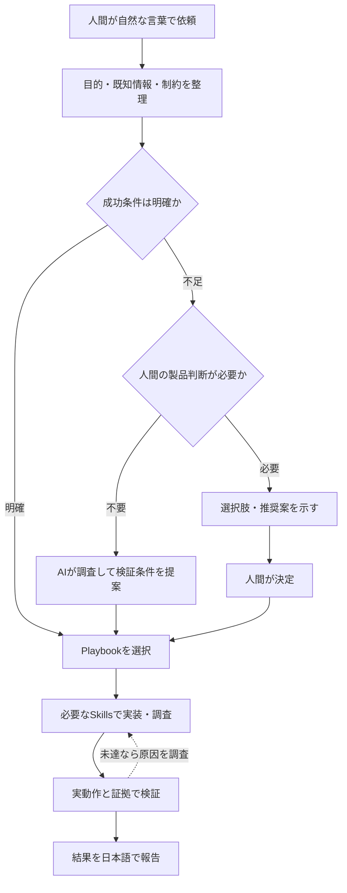
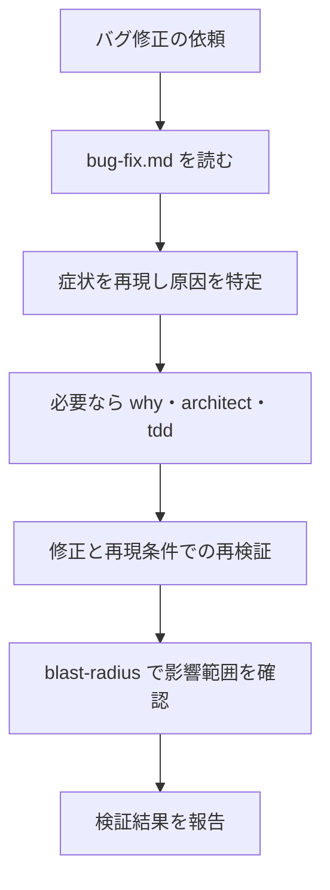

# 作業フロー

## 依頼から検証まで

[AGENTS.md](../../AGENTS.md) が共通原則と権限を定める。[workflow-router](../skills/workflow-router/SKILL.md) がPlaybookを選び、各段階で必要なSkillsを使う。人間は目的と製品判断を担当し、AIは調査・実装・検証方法を提案する。

## 例：バグ修正

使うSkillは課題に応じて選ぶ。[依頼の書き方](prompting.md) と [Skills・Playbooks一覧](../README.md) を参照する。
