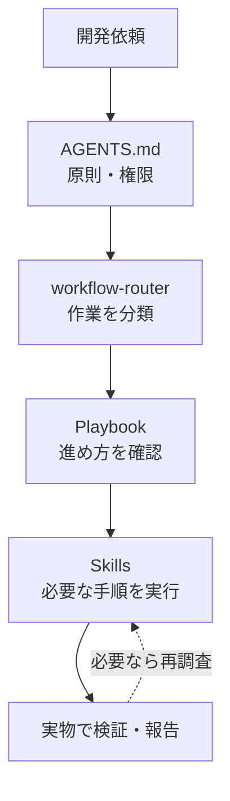
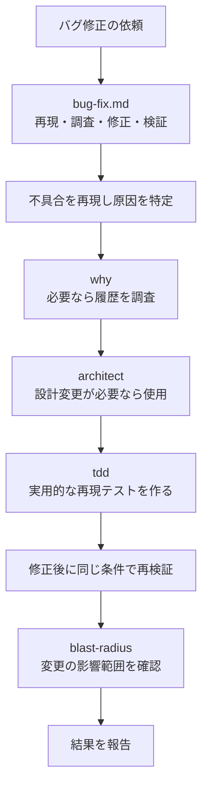

# 作業フロー

## 参照順序

- **[AGENTS.md](../../AGENTS.md)**：共通の開発原則と作業権限。
- **[workflow-router](../skills/workflow-router/SKILL.md)**：依頼に対応したPlaybookを選ぶ。
- **[Playbooks](../playbooks/)**：作業全体の流れ。例：調査→修正→検証。
- **[Skills](../skills/)**：各段階で使う技法。単独でも利用できる。

## 例：バグ修正

ここに示すSkillsは使用例であり、毎回すべてを実行するわけではない。調査だけなら[investigation](../playbooks/investigation.md)と[how](../skills/how/SKILL.md)、文書の改善なら[technical-writing](../skills/technical-writing/SKILL.md)など、作業に必要なものを選ぶ。
